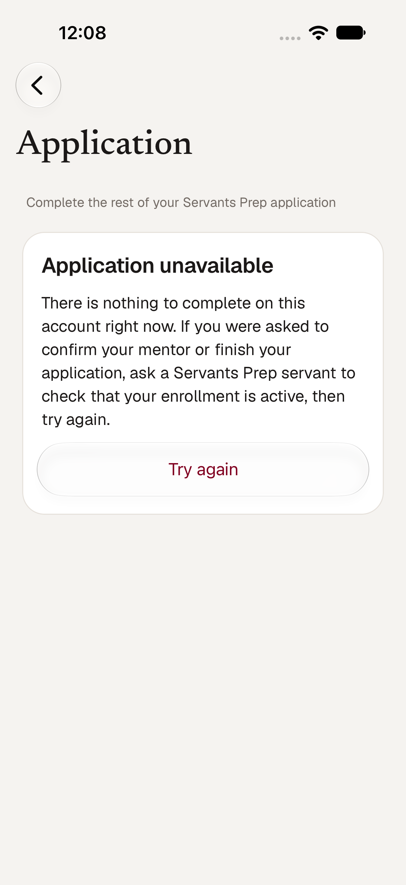
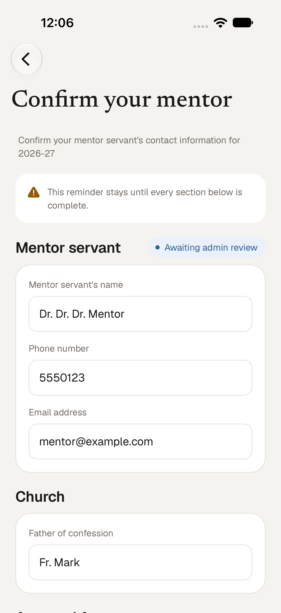
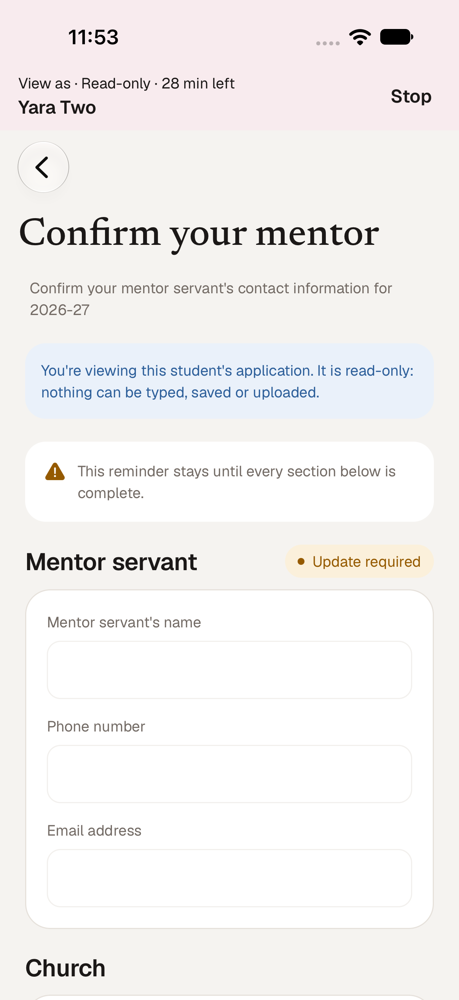
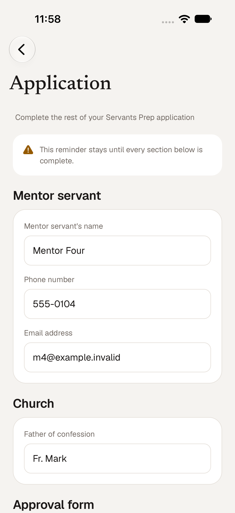

# Student Application: async parity and View As (follow-up to SMM-49)

This corrects the native **Application** screen (`app/prep-application.tsx`, rules in `data/prep-application.ts`); it does not
replace SMM-49. Everything comes from the existing `GET`/`PATCH /api/registration/application` and `POST …/upload`. No endpoint,
schema or permission was added. An earlier pass (PR #223, consolidated into #225) removed the false "Application unavailable"
wording and framed the annual confirmation; this pass finishes the View As and review-state parts.

| Async, no registration | Year 2, awaiting review | View As (read-only) | Async with a registration |
| --- | --- | --- | --- |
|  |  |  |  |

## Read this first: the server's rule for async students changed after #199

PR #199 (October 12) made every active async student confirm their mentor each year, with or without a registration. Commit
`ca44db5` (October 17, "limit annual mentor renewal to Year 2 students") reversed that: `requiresAnnualMentorUpdate` is now true
only for **Year 2** students, and its test is named "exempts an active async student with no cohort year". Verified against the
real route on this branch:

| Student | `GET /api/registration/application` | Native screen |
| --- | --- | --- |
| In-person Year 1, approved registration | 200, church + approval form, not annual | **Application**: mentor, church, approval form (unchanged) |
| Year 2, approved registration | 200, `annualMentorRequired`, `UPDATE_REQUIRED` → `PENDING_REVIEW` → `REVIEWED` | **Confirm your mentor** for the year, with the review badge |
| Yearless async **with** a registration | 200, not annual | The normal application |
| Yearless async **without** a registration | **404** "Application information not found" | A readable card with **Try again**; never mentions an approved registration |

So a yearless async student with no registration currently has nothing to confirm, and the web page shows its own "Application
unavailable" for that case too. The app cannot show a confirmation the server does not ask for (the PATCH would 404). The screen
follows the server's flags exactly, so **if the server asks again** (the #199 shape: annual required, no registration, no
cohort year) it already shows only the mentor section and the approval form, with no year anywhere. That shape is a test. If
the intent is that async students must confirm again, that is a server change (`lib/annual-mentor-requirement.ts`); say so and
the app will follow with no native change.

## What this pass changed

- **View As is read-only and scoped.** The read is keyed to the viewer and the effective student, so one account's application is
  never shown from another's cache entry. Fields are disabled, Save and the upload row are gone, the writers refuse even if called,
  a blue note says so, and **no draft is read or written** (a View As session must never touch the viewed student's draft).
- **Annual review state.** A badge beside "Mentor servant" from the server's `mentorReviewStatus`: *Update required*, *Awaiting
  admin review*, *Confirmed*. After saving, the message is the web's: "Mentor information submitted for admin review" (it was
  "confirmed", which the server had not yet done).
- **Not-found wording.** The card used to say the enrollment may be inactive or no year is active, which is wrong for an active
  async student. It now says there is nothing to complete right now and who to ask.
- **Unchanged:** the in-person flow, draft autosave, section flags, retry on every load failure including the first load offline.

## Verification

Simulator (iPhone 18 Pro) against the real API and a throwaway database, one account per shape: in-person, Year 2 (typed a
mentor, tapped Confirm: the database row exists, unreviewed, and the badge changed to *Awaiting admin review*), async with a
registration, async without (Try again re-asked and kept the card), and an administrator using View As on the Year 2 student.
Unit tests drive the real route handler through all of the shapes above and feed its answers to the native rules; a wiring test
pins the View As behavior.

**Not verified:** the approval-form upload against the current server. `origin/main` added a direct-to-Blob prepare/complete
upload (PR #313, `lib/approval-form-submission.ts`) for any file type up to 100 MB. It still accepts the old multipart request the
native app sends, so the upload keeps working, but with the old limits (PNG, JPG, GIF or PDF, 4.5 MB). Matching the web's new limits
is a separate change, and needs the 17 commits on `main` merged into this branch first. The Blob service itself is not reachable
from the local server (no `BLOB_READ_WRITE_TOKEN`), so uploads were never exercised here.
