# Attendance autosave and recovery in the iOS app (SMM-111)

Take attendance on the iPhone now behaves like the web editor from October 10–12
(web #214, #215, #217): every tap is kept on the device immediately, marks save to
the church on their own, a draft survives an interruption, and the save area says
exactly where the marks are and who saved last. It is an incremental follow-up to
SMM-50 and uses only APIs the server already deploys; no server change was needed.

| Idle | On this device only | Saving | Saved to the church |
| --- | --- | --- | --- |
| 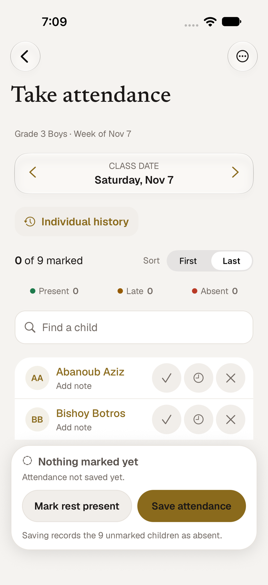 | 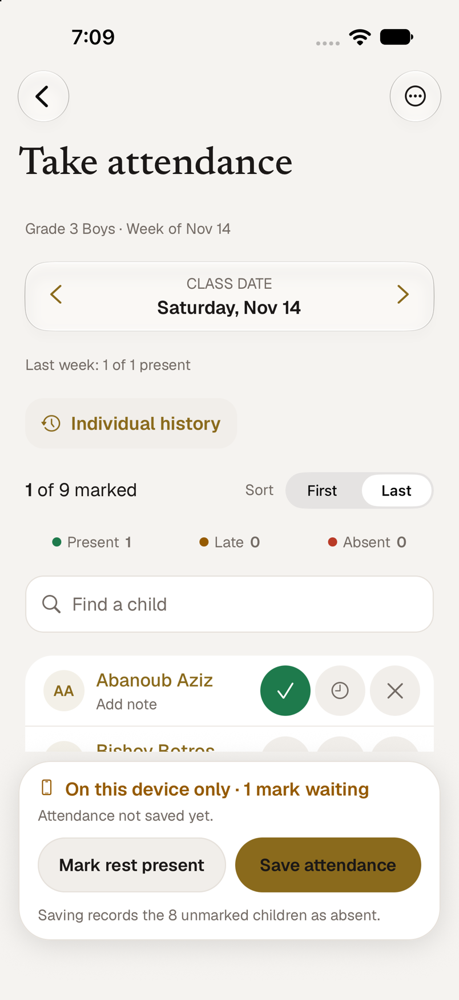 | 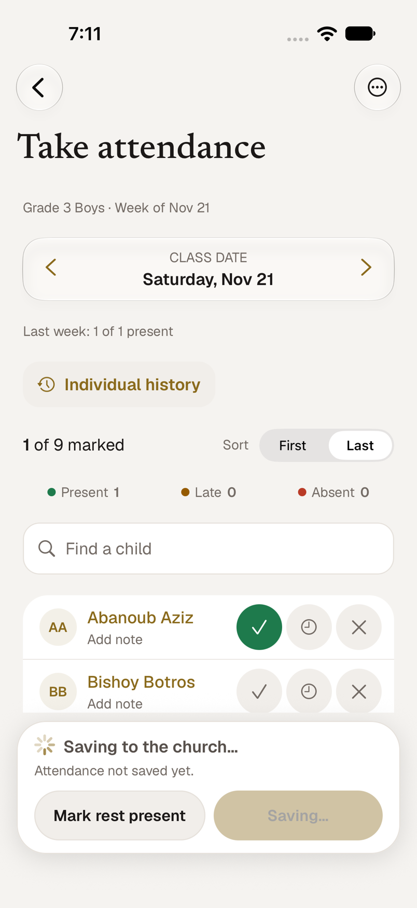 | 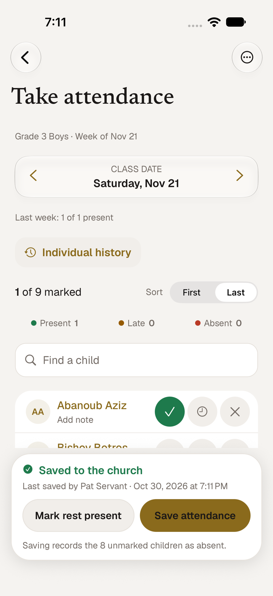 |

## What a servant sees

1. **Tap a mark.** It is on the device at that moment, and the bar says
   *On this device only · 1 mark waiting*.
2. **About 0.6 seconds after the last tap** the marks that were made are sent. The bar
   says *Saving to the church…*, and the roster stays fully usable: more taps can be
   made while a save is in flight.
3. **When the server confirms**, the bar says *Saved to the church* and shows *Last
   saved by Pat Servant · Oct 30, 2026 at 6:41 PM*. The name and time are the
   server's (`lastSavedBy` from the batch response and from the roster endpoint), not
   the phone's clock.
4. **Nobody is marked absent automatically.** Autosave only ever sends marks a person
   made. *Save attendance* is the deliberate last step: it records every child still
   unmarked as absent, asks first (*Mark 7 children absent?*), and sends the whole
   roster, as the web's Finish button does.

| Confirm | Done | Recorder and time (last week) |
| --- | --- | --- |
| 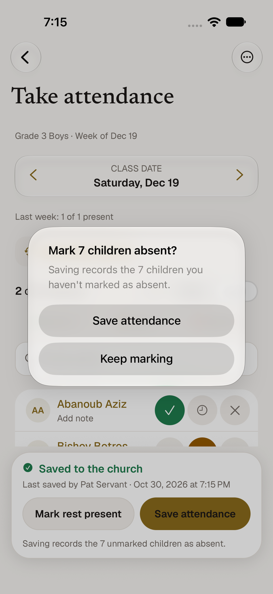 | 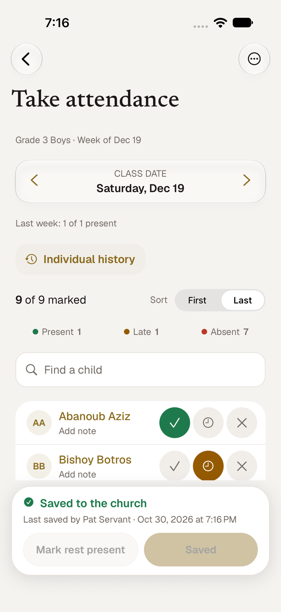 | 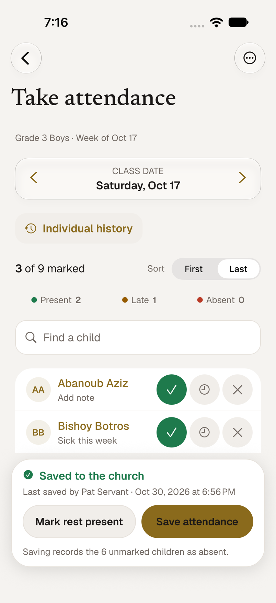 |

### The four states

| State | Bar says | Meaning |
| --- | --- | --- |
| Local only | *On this device only · N marks waiting* | Kept on the phone, not yet sent |
| Saving | *Saving to the church…* | A request is in flight |
| Church saved | *Saved to the church* + recorder and time | The server confirmed it |
| Failed | *Not saved · kept on this device* + a banner | Not confirmed; nothing is lost |

A fifth, *Recovered N marks · not saved yet*, covers a draft found on the device (below).

## Interruptions and failures

| Offline: retrying | Recovered after the app was killed | After Resume |
| --- | --- | --- |
| 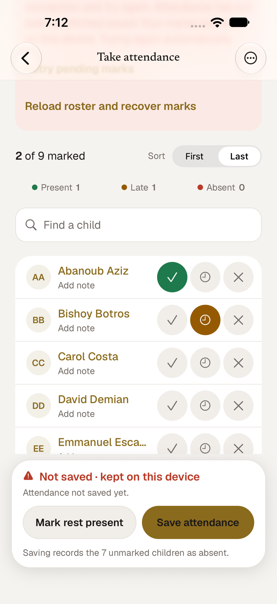 | 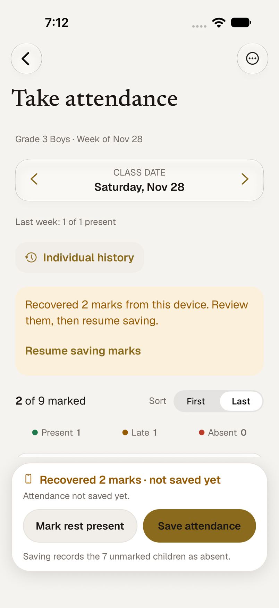 | 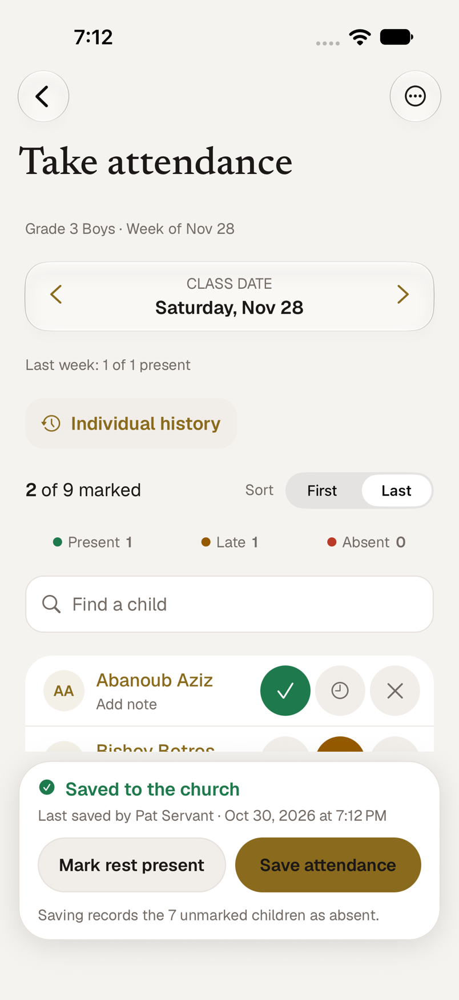 |

- **Transient failures retry by themselves while the same roster is open**: no
  connection, a timeout, a 5xx, a 429. The wait grows (5, 10, 20, then every 30 seconds),
  and coming back to the app sends right away. Marks stay on screen and on the device.
- **A refusal waits for a person.** A 403 (the servant no longer serves the class), a
  400 (a child is not on the roster), a 409 (the signed-in account changed) and every other
  4xx is shown with *Retry pending marks* and *Reload roster and recover marks*. It is
  never retried automatically, and a new tap does not re-arm it.
- **Interruption.** A draft is kept on the device on every tap, and the exact
  submission is written before a save leaves. If the app is killed mid-save, the next
  open finds the draft; resending the same marks is the same request, so nothing doubles.
- **Recovery waits for a current roster.** A draft is only offered after a fresh,
  authorized roster loads, and nothing is sent until the person taps *Resume saving
  marks*. Children who have left the class are dropped (and counted), children who joined
  stay unmarked, and a mark the server already holds is not resent.

| Refused (403) | Roster changed: refused | After reload |
| --- | --- | --- |
| 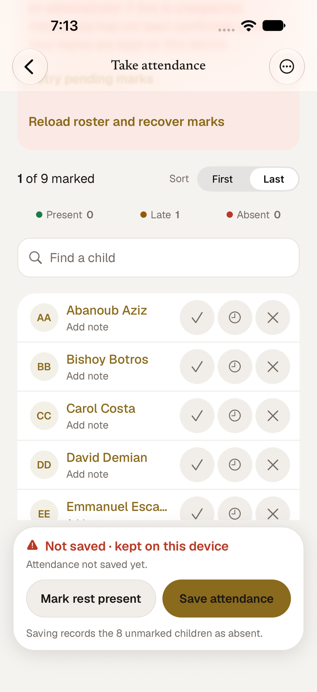 | 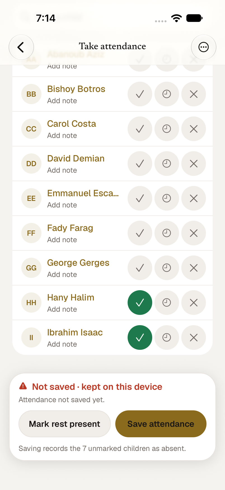 | 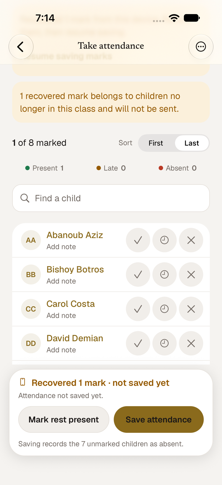 |

## Rules, and where each lives

| Rule | Where |
| --- | --- |
| Draft scoped to account, class and date; written on every tap | `data/attendance-editor.ts` (`mark`, `persistDraft`); key in `data/attendance-draft.ts` (`attendanceDraftStorageKey`) |
| Debounced autosave of pending marks only | `AttendanceEditor.rearm` / `save(false)` |
| Acknowledgment clears only the submitted revision | `afterAcknowledgment` (a tap or note changed during the save stays pending) |
| Transient failures retry; refusals do not | `attendanceFailure` (status → retryable) and `canAutosave` |
| Recovered drafts need a fresh roster and an explicit Resume | `AttendanceEditor.load` (reads the draft only after the roster arrives), `resume()` |
| Removed children dropped, new children unmarked | `mergeAttendanceDraft` |
| No automatic absence; explicit save marks the rest absent | `save(true)` is the only place that adds `ABSENT` |
| Abort on account, class or date change | `use-attendance-editor.ts`: a new key creates a new editor; the old one is disposed and its request aborted |
| `expectedUserId` on every write | session create and batch body in `save()` |
| Read-only and View As never write | `canEdit` is false: no draft read, written or sent; the API client also refuses writes in View As |
| Existing marks stay visible during refresh and autosave | `refreshing` keeps the roster; saves wait while a refresh is reading so old marks cannot come back |
| Recorder and save time from the API | `lastSavedBy` in state, shown by `components/attendance-save-area.tsx` |

Notes are part of the draft. A save always sends back the note the server already holds for
a child (the batch route clears a note it is not sent), and a note typed on an already marked
child is sent with that child's mark.

**Storage.** Drafts live in the Keychain (`expo-secure-store`, *after first unlock, this device
only*): child IDs, marks and typed notes only, never names, photos or contacts. The key is
`stmark.attendance-draft.v1.<user>.<class>.<date>`. (The previous notes draft used a key with a
`:` in it, which SecureStore rejects, so it never actually persisted; it is replaced by this.)

**Connectivity.** There is no reachability library in the app, so "reconnection" is the retry
timer plus coming back to the foreground, not a network-change event.

## View As, read-only and other states

| View As (read-only) | Empty class | Loading | Could not load |
| --- | --- | --- | --- |
| 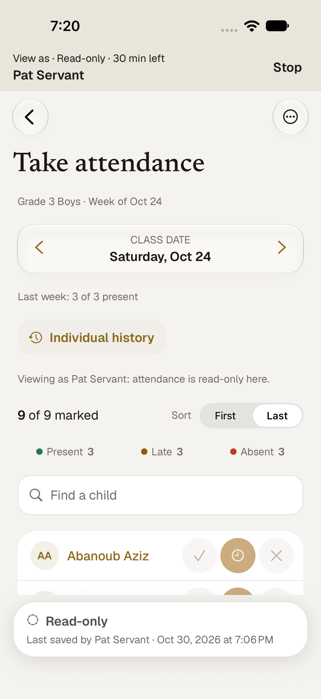 | 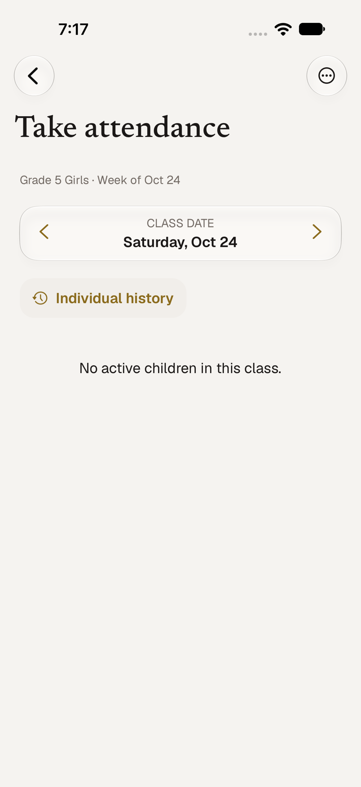 | 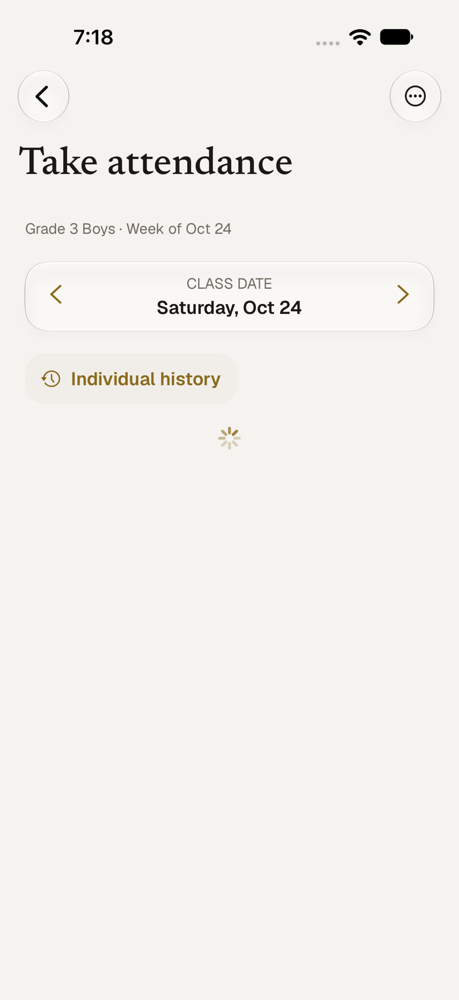 | 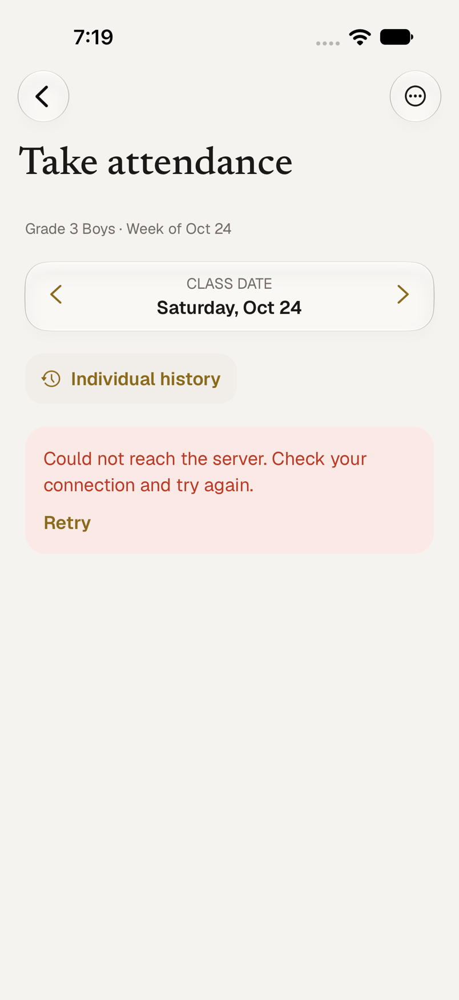 |

| Dark: failed | Dark: saved | Largest text size |
| --- | --- | --- |
| 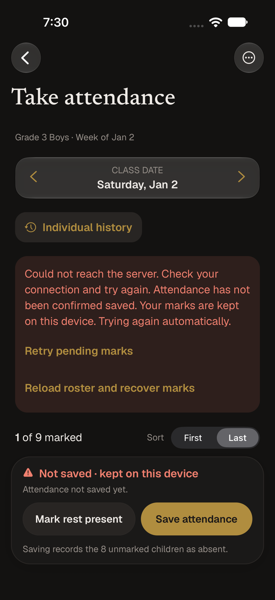 | 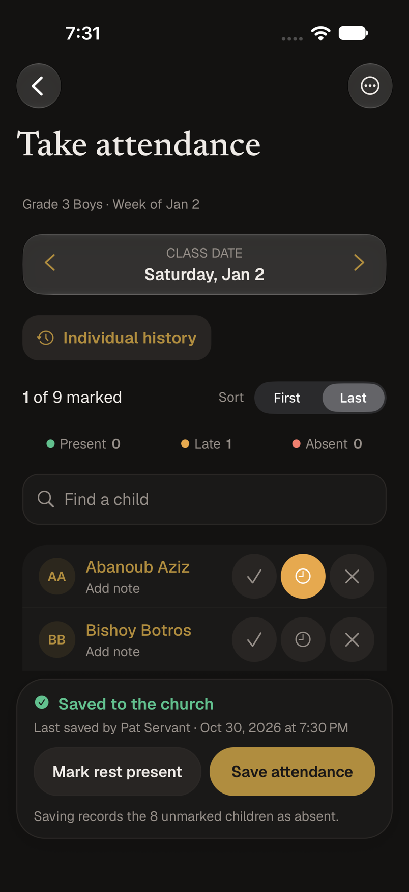 | 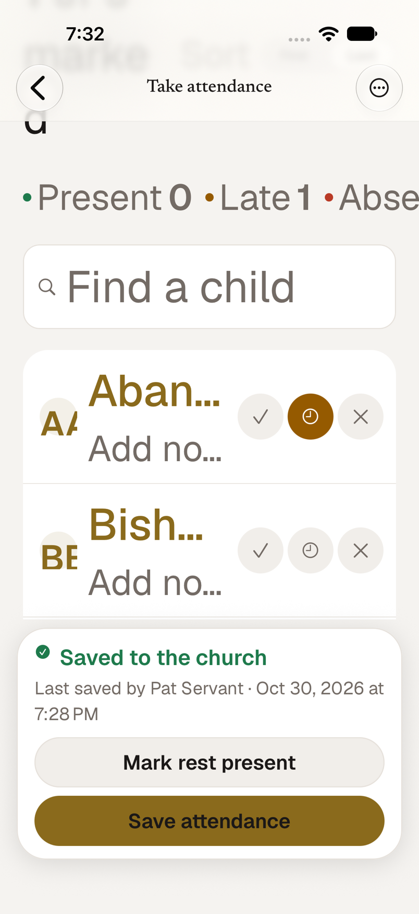 |

The save bar caps its own text scaling (1.3×) and stacks its two buttons at large sizes, so
it never takes over the screen; the notices above the roster scale fully and scroll.

## Verification

**Automated** (`bun test:run`, `bunx tsc --noEmit` in the root and `apps/mobile`, `bun lint`):

- `__tests__/mobile/attendance-editor.test.ts` (50): every rule above against a scripted server
  with fake timers: scoped key and write-before-send, debounce, `expectedUserId`, acknowledgment
  clearing only the submitted revision (a tap, a repeat and a note during the save), notes sent
  back, backoff retries, foreground flush, interruption and resume, 403/400/409 never retried,
  roster transfer, recovery rules, explicit save, account/class/date abort, read-only, refresh
  races, recorder context, storage failure, draft format.
- `__tests__/mobile/use-attendance-editor.test.tsx` (6): the hook with a mocked store and
  request: account change aborts the old save and hides its marks, week change, View As,
  AppState flush, recovery.
- `__tests__/mobile/attendance-editor-wiring.test.ts` (11): the screen goes through the editor,
  disables editing in View As, confirms before marking absent; notice and status wording.

**Simulator** (iPhone 18 Pro, iOS 27, a real dev API on a throwaway database, a servant, a
second servant and an admin). Each scenario was run against the server, and its rows read back:

| Scenario | Result |
| --- | --- |
| One tap | Saved on its own; only that child recorded; recorder and time shown; reminders refreshed |
| Server down, then back | *Not saved*, marks kept, retried by itself, saved when the server returned |
| App killed with unsent marks | Relaunch: *Recovered 2 marks*, nothing sent; Resume sent them |
| Save in flight (server frozen), then another tap | The tap showed at once; both marks saved, in two requests |
| Servant's assignment ended mid-session | 403 shown as a permission problem; exactly one request in 20 s; marks kept |
| Child moved to another class mid-session | 400 shown; Reload dropped that child and counted it; Resume saved the rest |
| Child moved out and another added while the draft sat on the device | Moved child dropped with a notice; new child unmarked; no absence inferred |
| Other account on the same class and date | No draft and no banner; nothing sent; the first account got its draft back on return |
| Last week's session saved by someone else | Their name and time shown; their note survived an autosave |
| Save attendance with unmarked children | Confirmation, then the unmarked children recorded absent |
| View As | Read-only text, buttons hidden, zero requests that write, data unchanged |
| Empty class, loading, could not load (and Retry) | Distinct states |
| Light, dark, largest text size | Readable; bar stays compact |

**Not verified:** a physical iPhone (the roster and tap behaviour is the same code, but a real
background suspension and a real Wi-Fi drop were simulated with a killed app and a stopped
server); the stored draft was exercised through SecureStore on the simulator, not on a device.
