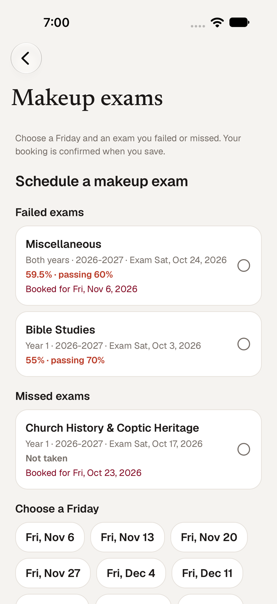
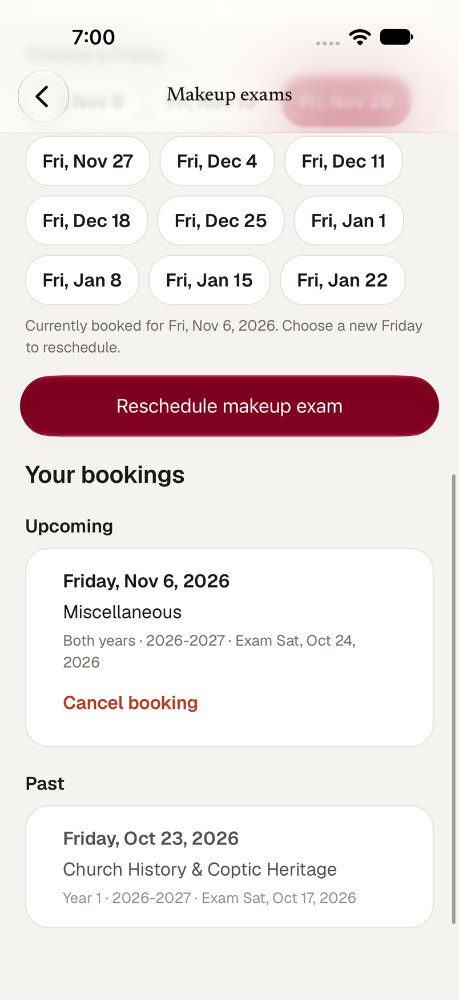
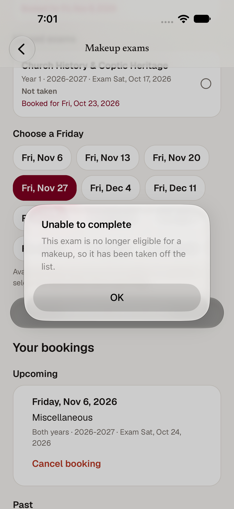
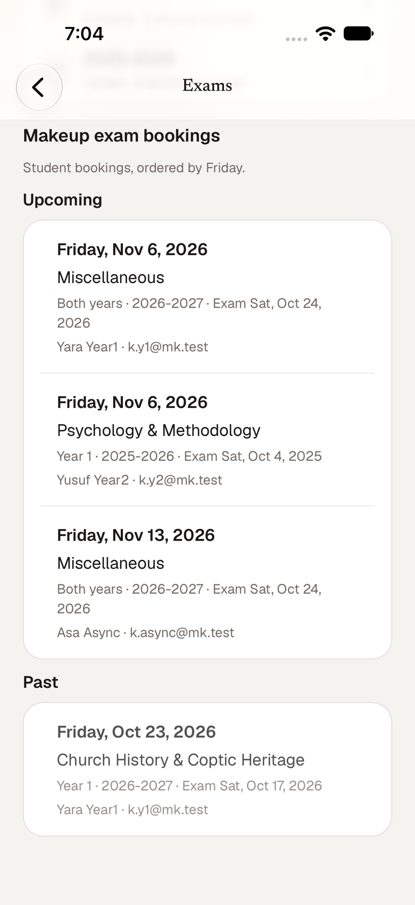
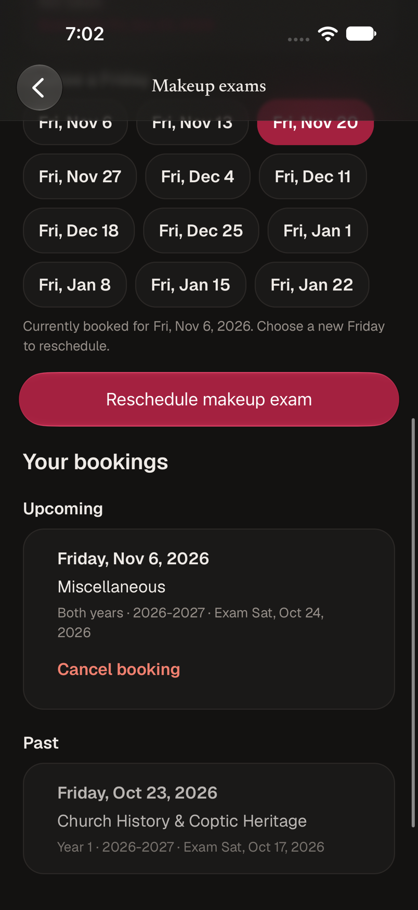
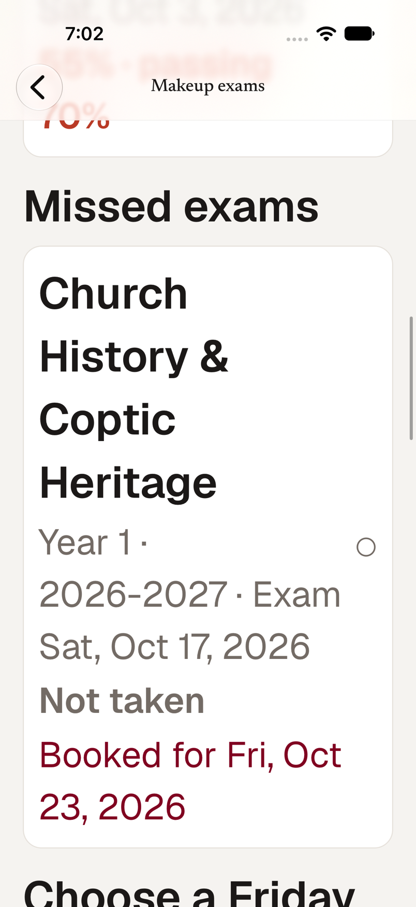

# Makeup exams in the iOS app (SMM-113)

Servants Prep students schedule a retake of a failed or missed exam from the app, and staff see
every student's booking on the **Exams** screen. It is the native version of the web feature in
[`makeup-exams.md`](makeup-exams.md) and uses only the deployed `/api/makeup-exams` endpoints
(GET, POST, DELETE). The server decides who is eligible and which Fridays are offered; the app
shows that and never invents a time, location, capacity limit or approval step.

| Student: failed first, then missed | Reschedule | Eligibility changed before save |
| --- | --- | --- |
|  |  |  |

## Students

Open **Makeup exams** from the student home, **More**, or a makeup-exam notification.

1. **Choose an exam.** Failed exams are listed first with the student's current percentage and the
   section's passing percentage (*55% · passing 70%*), then missed exams (*Not taken*). An exam
   that already has a booking says when.
2. **Choose a Friday** from the dates the API returns: the next 12 Fridays after today's calendar
   date in New York.
3. **Save.** *Schedule makeup exam*, or *Reschedule makeup exam* when that exam already has an
   upcoming booking (POST is an upsert, so saving again moves it). A confirmation or the reason it
   failed arrives as an alert, because the button is usually far from the top of a long screen.
4. **Your bookings** lists upcoming bookings (each with *Cancel booking*, after a confirmation) and
   past ones, which stay as history with no cancel button. A booking can be cancelled while its
   Friday is after today in New York.

What counts as eligible is decided by the server (`app/api/makeup-exams/route.ts`): an active
enrollment; an exam before today that has no score or a percentage below its section's passing score
(equal to it is passing); Year 1 sees Year 1 and shared exams, Year 2 also sees Year 1 exams, an async
student (no year) covers both; exams from academic years before the enrollment's starting year are
excluded. A student who is not active gets an empty list.

**One booking per exam.** If an exam's old booking is in the past, saving a new Friday replaces it
(the server keeps one booking per student and exam). The screen says so before you save: *This exam
was booked for Fri, Oct 23, which has passed. Saving books a new Friday and replaces that booking.*

**Eligibility changing before save.** The server checks again on save. If the exam became passing, or
the Friday left the window as the New York day moved on, the app shows the refusal in plain words,
reloads the list, and drops only the exam or Friday that is no longer valid. It also reloads by itself
when the New York calendar day changes.

## Staff

**Exams → Makeup exam bookings** (administrators, priests and Servants Prep servants, the same people
the API treats as staff): every student's booking with the Friday, the exam, and the student's name and
email, upcoming first and past below, each ordered by Friday and then by student name. It is read-only.
A mentor or a Sunday School-only account has neither staff nor student access: the API answers 403 and
the app shows no list.

| Staff list | Dark | Largest text |
| --- | --- | --- |
|  |  |  |

During View As the student screen is read-only: choosing and saving are disabled and the API client
refuses the writes.

Where it lives: `app/prep-makeup-exams.tsx` (student screen), `components/makeup-bookings-staff.tsx`
(staff list), `data/makeup-exams.ts` (pure rules), shared types in
`packages/contracts/src/makeup-exams.ts` (type-only). The notification link `student/makeup-exams`
used to open the staff Exams screen, which students cannot use; it now opens the student screen.

## Verification

**Automated:** `bunx tsc --noEmit` (root and `apps/mobile`), `bun lint`, `bun test:run`.
`__tests__/mobile/makeup-exams.test.ts` (17) covers who sees what, failed-before-missed grouping and the
percentage wording, reading dates in UTC, the New York boundary against the server's own helper
(`makeupToday` and `upcomingMakeupFridays` at 04:59:59Z and 05:00:00Z, and across the March change),
cancel eligibility on the Friday itself, history, staff ordering, the save checks, selection
reconciliation, each refusal's wording, and the wiring (writes only in Schedule and Cancel; no invented
times, places, capacity or approval).

**Simulator** (iPhone 18 Pro, iOS 27, the real dev API on a throwaway database, dropped afterwards):
a Year 1 student, a Year 2 student, an async student, an inactive student, an administrator, a priest, a
Servants Prep servant, a mentor and a Sunday School servant.

| Case | Result |
| --- | --- |
| Year 1 student | Failed exams first (59.5% · passing 60%, 55% · passing 70%), then the missed one; the passing exam, the Year 2 exam, last year's exam, a future exam and an exam dated today are not offered |
| Year 2 and async students | Year 2 sees Year 1 and last year's exams; async covers both years but not exams from before their starting year |
| Inactive student | "You have no failed or missed exams available to schedule." |
| Reschedule | The same booking moved from Nov 13 to Nov 20 (one row, same ID) |
| New booking | Created; the past booking for another exam stayed as history |
| Past booking on the chosen exam | Warned that saving replaces it |
| Cancel | Confirmation, booking gone, past booking untouched and not cancellable |
| Exam became passing before save | Refused in words, exam removed from the list, the chosen Friday kept |
| Staff (administrator) | Four bookings ordered by Friday then student, past ones below; a priest and a Servants Prep servant get the same from the API |
| Mentor and Sunday School servant | The Exams screen says it is for administrators, the makeup screen says it is not available, and the API answers 403 |
| Light, dark, largest text size | Readable; text wraps rather than clips |

**Not verified:** the New York midnight boundary on a device (the simulator and server share the real clock,
so the boundary is covered by the tests against the server's helper rather than by waiting for midnight);
a physical iPhone; a priest and a Servants Prep servant viewing the list in the app (their access was
confirmed on the real API, the screen was exercised as the administrator).
