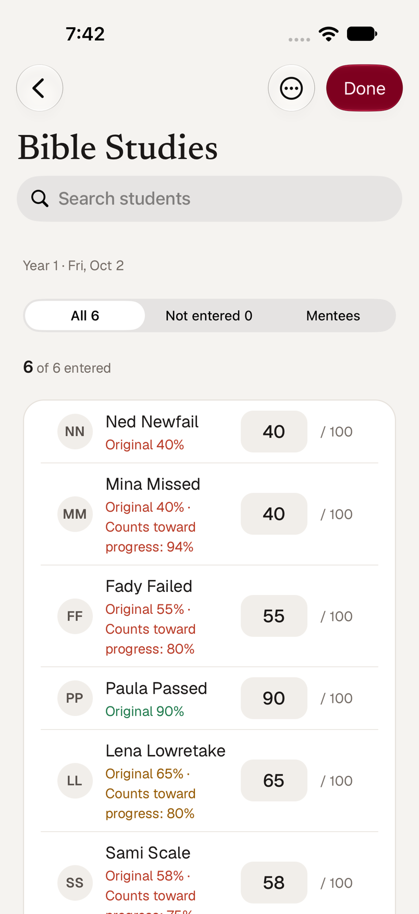
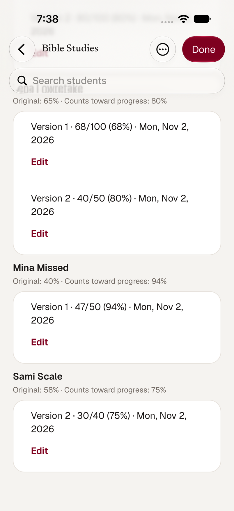
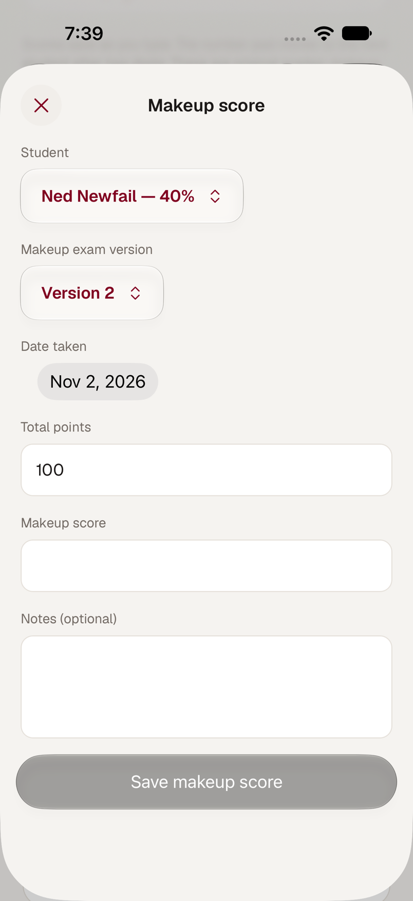
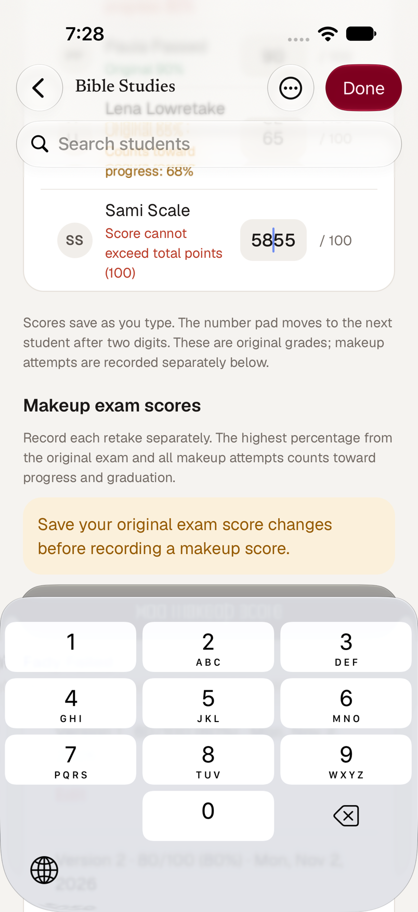
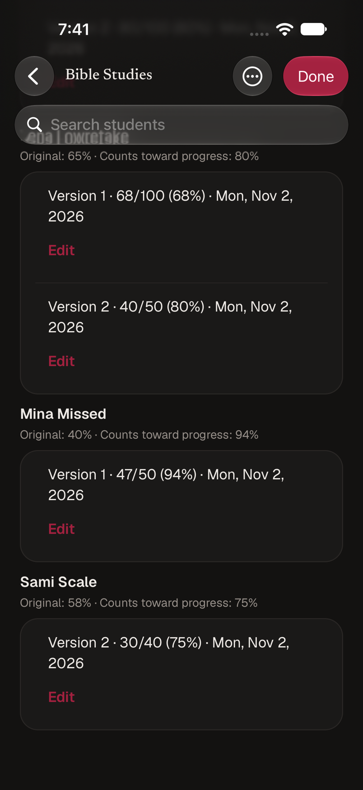
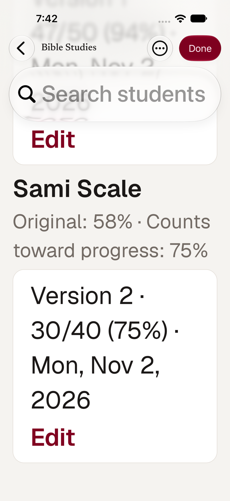

# Makeup exam scores in the iOS app (SMM-114)

The staff score screen (**Exams → an exam**) now records makeup attempts separately from the original
grade, as the web's grading screen does ([`makeup-exams.md`](makeup-exams.md), "Makeup exam scores"). It
uses the deployed `/api/exams/[id]/makeup-scores` (GET, POST, PATCH) and the existing original-score
routes. The server validates every write, keeps the original grade, and recalculates the effective best
result in one transaction; the app shows what it returns.

| Original grades, with the best result beside them | Every attempt, editable | Add a makeup score |
| --- | --- | --- |
|  |  |  |

## Original and effective grades are separate

The score list is the **original** editor. Each row reads `originalScore` / `originalPercentage` and says
*Original 55%*; when a makeup raised the result it adds *Counts toward progress: 80%* beside it, never in
its place. A missed exam with a makeup-only result reads *Not entered · Counts toward progress: 88%
(makeup)* and its field is empty.

This fixes a real hazard in the previous screen, which filled the field from the effective best (`score`)
and would have overwritten a makeup result as if it were the original on the next save. The original editor
now sends only the score it was given (`PATCH /api/exam-scores/[id]` with `{ score }`), and does not send a
write when a field is left unchanged. The server's own rule then recalculates the effective result.

## Makeup attempts

**Makeup exam scores** (under the list; administrators, priests and Servants Prep servants) shows every
attempt for every student, kept visible and editable: *Version 2 · 44/50 (88%) · Mon, Nov 2, 2026*, with notes,
the student's original grade, and what counts toward progress.

*Add makeup score* (or *Edit* on an attempt) opens a sheet with the student, version 1 or 2, date taken,
total points (the exam's own total by default, but each makeup has its own), score with a live percentage,
and optional notes. Rules match the server's (`lib/makeup-scores.ts`): a whole-number total, a score from
zero to the total, a date on or before today in New York, and, spelled out instead of the server's generic
refusal, not before the exam it retakes. Historical grading needs no booking.

- **Who can be graded.** Students with no result (missed) or below the passing score; the student whose
  attempt is being corrected stays in the list. A student whose best result reaches the passing score leaves
  the list, but their attempts stay visible and editable.
- **Highest wins, atomically.** The best percentage across the original and all attempts is the effective
  grade, normalized onto the exam's points. A lower retake never lowers it. Correcting an original or an
  attempt recalculates it.
- **Original unsaved.** While an original-score field holds something not yet saved (or a save failed), *Add*
  and *Edit* are held back with a banner, as on the web.
- **Authorization** is the server's: current role tags. Administrators, priests and Servants Prep servants
  grade; a mentor (who sees a read-only list), a student and a Sunday School-only account are refused with 403.
  During View As the section is read-only.

| Original unsaved: invalid score, makeup held back | Dark | Largest text |
| --- | --- | --- |
|  |  |  |

Where it lives: `app/prep-exam/[id].tsx` (the original editor, fixed), `components/makeup-scores-section.tsx`
(attempts and the sheet), `data/makeup-scores.ts` (pure rules), shared types in
`packages/contracts/src/makeup-exams.ts` (type-only).

## Verification

**Automated:** `bunx tsc --noEmit` (root and `apps/mobile`), `bun lint`, `bun test:run`.
`__tests__/mobile/makeup-scores.test.ts` (33) checks the form against the server's own `parseMakeupScoreInput`
case by case (same accept/refuse decision, same normalized body, same wording), the best-result rule against
the server's `effectiveExamResult` (lower retake, best of several, makeup-only, different point scales), how
original and effective grades read, who can be graded, the original-unsaved guard, refusal wording, and the
wiring (the original editor reads and writes original fields only; the section is graders-only and writes only
through Save).

**Simulator** (iPhone 18 Pro, iOS 27, the real dev API on a throwaway database, dropped afterwards; an exam
out of 100 passing at 70):

| Case | Result |
| --- | --- |
| Missed original, makeup 44/50 | Attempt saved; no original; effective 88% (makeup-only) |
| Different scale: 30/40 | 75% on the exam's scale; the student passes and leaves the picker, attempt stays |
| Lower retake: 65% original, 50/100 | Effective stayed 65% |
| Both versions: 60/100 then 80/100 | Both kept; effective 80% |
| Corrected retakes | 44/50 → 47/50 raised 88% to 94%; 50 → 68 raised 65% to 68% |
| Corrected originals | Sami 55 → 58 and Mina (makeup-only) blank → 40: originals changed, effective results (75%, 94%) untouched |
| Invalid original ("5855") | Refused with the server's wording; makeup held back until fixed |
| Priest | Recorded a makeup (40/50 = 80%) with the priest as grader |
| Mentor, student, Sunday School servant | 403 on the API for both reading and writing; the mentor sees the read-only list with no makeup section, the Sunday School servant sees nothing |
| Server refusals | A date before the exam, and a passing student, answered 400 and wrote nothing |
| Light, dark, largest text size | Readable; text wraps |

**Not verified:** a physical iPhone; an exam that becomes passing while the sheet is open (covered by the picker
rule and the server's refusal, exercised through the passing-student request); loading and error states on this
section beyond the shared resource handling.
