# Passkeys in the iOS app

Native passkey sign-in and **Account → Passkeys** (web
[#242](https://github.com/Saint-Mark-s-Ministry/saint-marks-ministry/pull/242)).
It uses the passkey API the web already ships, [`docs/passkeys.md`](passkeys.md),
and the normal NextAuth session. There is no second sign-in system.

- [What it does](#what-it-does)
- [How it works](#how-it-works)
- [What the server needs](#what-the-server-needs)
- [What the build needs](#what-the-build-needs)
- [What a person sees](#what-a-person-sees)
- [Security](#security)
- [Screenshots](#screenshots)
- [Testing](#testing)
- [Troubleshooting](#troubleshooting)
- [Where the code is](#where-the-code-is)

## What it does

- **Sign in with a passkey** on the sign-in screen. No email to type. Password,
  "New here? Get started" and "Forgot password?" are untouched.
- **Account → Passkeys**: list your own passkeys with the date added and last
  used, add one with a friendly name, remove one after a confirmation.
- Offered **only when the server says so**: `GET /api/public/passkeys` must
  answer `enabled` and `ios`, and its `rpId` must be the domain this build was
  associated with. Anything else (feature off, older server, unreachable, a
  build with no associated domain, an older binary without the native module)
  shows nothing, and nothing else changes.

## How it works

The app asks for the same challenges the web does, shows Apple's system passkey
sheet, and returns the result to the same verification and NextAuth routes.

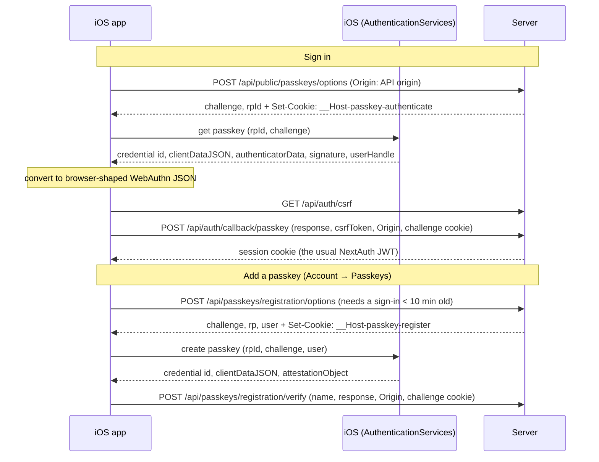

### Why a native response cannot be posted unchanged

The server verifies a browser-shaped response against an exact origin, an RP ID
and a challenge held in a cookie. Four things differ on native, and each is
handled:

| Difference | What the app does |
| --- | --- |
| iOS returns raw `Data` fields under other names (`rawClientDataJSON`, `credentialID`, `userID`) and no transports. | The native module returns base64url strings and `apps/mobile/src/data/passkeys.ts` converts them to the JSON the verifier reads, with `transports: ["internal", "hybrid"]`. |
| The verifier requires `Origin` to equal `PASSKEY_ORIGIN`; an app has no page origin. | The app sends its **API origin** as `Origin` on passkey requests only. The API host must therefore be the configured origin. |
| The challenge lives in an HttpOnly cookie. | The app's private cookie jar holds `__Host-passkey-register` / `__Host-passkey-authenticate` **in memory** for one exchange and sends them only on passkey requests. Only the session token is ever stored. |
| iOS embeds `https://<RP ID>` as the origin inside `clientDataJSON`. | The verifier accepts `https://<RP ID>` as an extra origin, **only while `PASSKEY_IOS_APP_IDS` is set**. When the RP ID is the web origin's own host (recommended) there is nothing extra to accept. |

## What the server needs

| Setting | Value | Notes |
| --- | --- | --- |
| `PASSKEY_RP_ID` | `www.stmarkministry.app` | **Choose this one.** See below. |
| `PASSKEY_ORIGIN` | `https://www.stmarkministry.app` | The exact web origin, which is also the API origin the app uses. |
| `PASSKEY_IOS_APP_IDS` | `TEAMID.org.stmark.ministryportal` | Comma or space separated App IDs. The team that signs the App Store build, not a developer's personal team. Unset means the iOS app is off. |

**Why `www`.** iOS lets an app use passkeys only for a domain that lists the app
in `https://<RP ID>/.well-known/apple-app-site-association`, fetched **without
following redirects**. Production redirects the apex (`stmarkministry.app`) to
`www`, so an apex RP ID could not serve it. An RP ID cannot be changed later
without losing every enrolled passkey, so decide before anyone enrolls.

The server serves that file from `app/.well-known/apple-app-site-association/route.ts`:

```json
{ "webcredentials": { "apps": ["TEAMID.org.stmark.ministryportal"] } }
```

It is a plain 404 unless passkeys and an iOS App ID are both configured.

`GET /api/public/passkeys` answers:

```json
{ "enabled": true, "rpId": "www.stmarkministry.app", "ios": true }
```

`rpId` and `ios` are additive; the web login ignores them. A server that
predates native support sends neither, so the app never offers passkeys there.

## What the build needs

- `plugins/withPasskeyDomain.js` adds the `webcredentials:<domain>`
  associated-domain entitlement at prebuild. The domain is the host of
  `EXPO_PUBLIC_API_URL`, or `PASSKEY_ASSOCIATED_DOMAIN` when the RP ID is a parent
  domain. It also writes the domain to Info.plist (`StMarkPasskeyDomain`), which
  the native module reads back so the app can compare it with the server's `rpId`.
  (It cannot ride in Expo `extra`: a dev client takes its config from Metro, which
  skips plugins.)
- A build whose API URL is an IP address (a local dev client) gets no entitlement
  and no domain, so the app never offers passkeys.
- `PASSKEY_ASSOCIATED_MODE=developer` appends `?mode=developer`, which makes a
  device fetch the association file directly instead of through Apple's CDN. For
  testing only; never for a release build.
- **The Associated Domains capability needs a paid Apple Developer team.** A free
  personal team cannot sign a build with it.

## What a person sees

| Situation | Result |
| --- | --- |
| Server has passkeys on, iOS enabled, build associated | Sign-in button and Account row appear. |
| Passkeys off, iOS App ID unset, older server, unreachable, no module, wrong domain | Nothing appears. |
| Sign in with a passkey, then cancel | A quiet message ("Passkey request cancelled or timed out…"); nobody is signed in. |
| Unknown, disabled, replayed or expired credential | One generic message ("Unable to sign in with this passkey. Try again or use your password.") |
| Passkey sign-in for an account that must change its password | The existing "Change your password" gate. |
| Add / remove with a sign-in older than 10 minutes | A "Sign in again first" card with a Sign out button, from the session's `authenticatedAt` (advisory) and again when the server refuses. After a refusal Add and Remove are disabled and the typed name is kept. |
| Ten passkeys already | Add is disabled with an explanation. |
| Cancel the create sheet | "Passkey setup was cancelled. Nothing was added." The typed name is kept. |
| Remove | A confirmation first. The server scopes the delete to the signed-in owner. |
| View As | Account row hidden; the screen is read-only. The app never calls `/api/passkeys` (see below). |
| Rate limited, expired or replayed challenge on add | The server's own message. |

Every control locks while a request runs, so a double tap sends once.

## Security

- **View As.** The server answers every `/api/passkeys` request made during View
  As with **401**, which the app reads as an expired session and signs the person
  out. So the client refuses all `/api/passkeys` calls itself, before the
  network. Writes during View As are also blocked by the server with 403
  `ViewAsReadOnly`.
- **Credentials stay off the device and out of logs.** The challenge cookie is
  in memory only; only the session token is persisted. No passkey code logs
  (a test enforces it).
- **Removal cannot affect another user's passkey.** The app sends only the
  passkey id; the server deletes `where id, userId = session user, rpID`.
- **The server is the authority.** Disabled accounts, the ten-minute rule, the
  limit of ten, challenge expiry and replay, origin and RP ID are all enforced
  server-side. The app's copy of any of them is advisory or presentational.
- **Cache.** The passkey list is cached per signed-in user and dropped when the
  identity changes. The capability answer is cached for five minutes.

## Screenshots

iPhone 18 Pro simulator, iOS 27, real Apple passkey sheets, a real server.

### Sign in

| Light | Dark | Large text |
| --- | --- | --- |
| 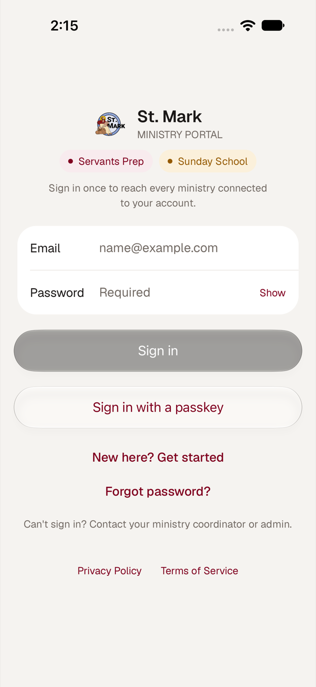 | 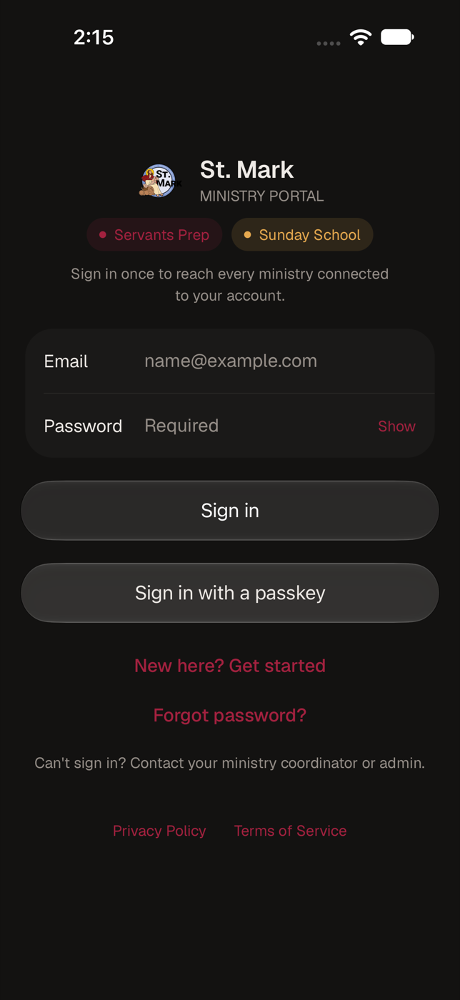 | 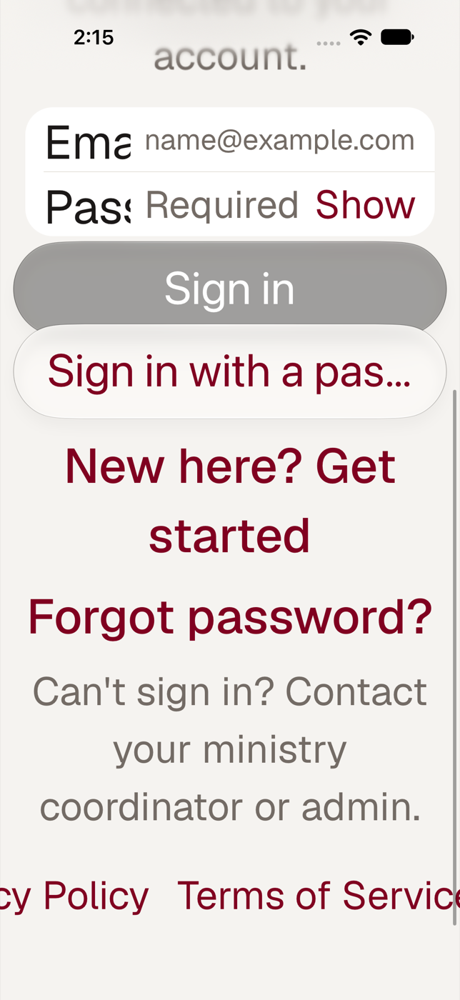 |

| System sheet |
| --- |
| 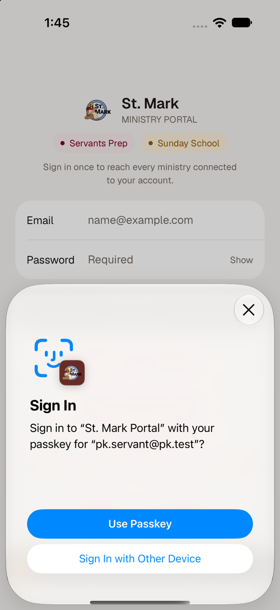 |

### Add, list and remove

| Account row | System sheet | List (light) |
| --- | --- | --- |
| 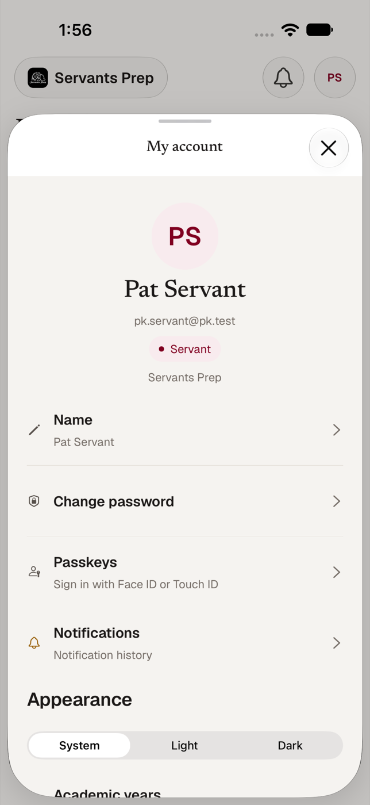 | 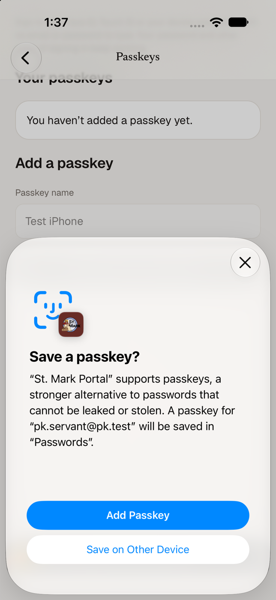 | 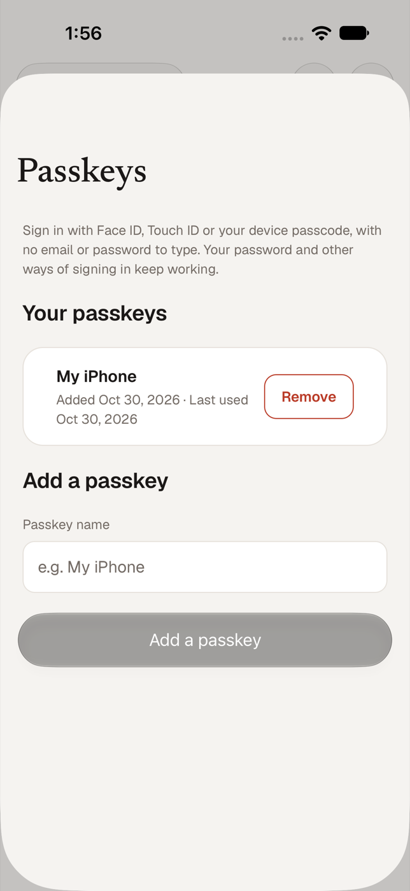 |

| List (dark) | List (large text) | Remove confirmation |
| --- | --- | --- |
| 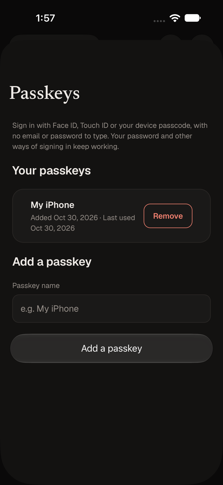 | 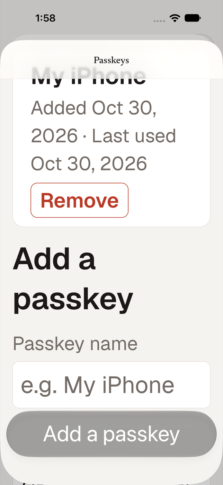 | 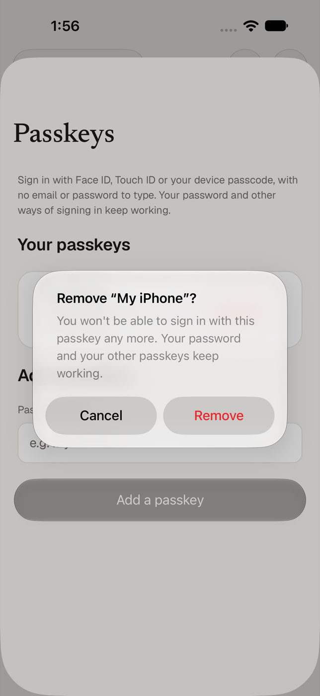 |

| After removing | Cancelled |
| --- | --- |
| 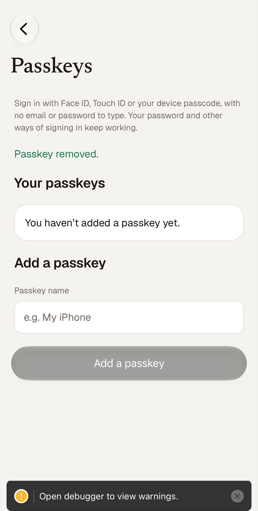 | 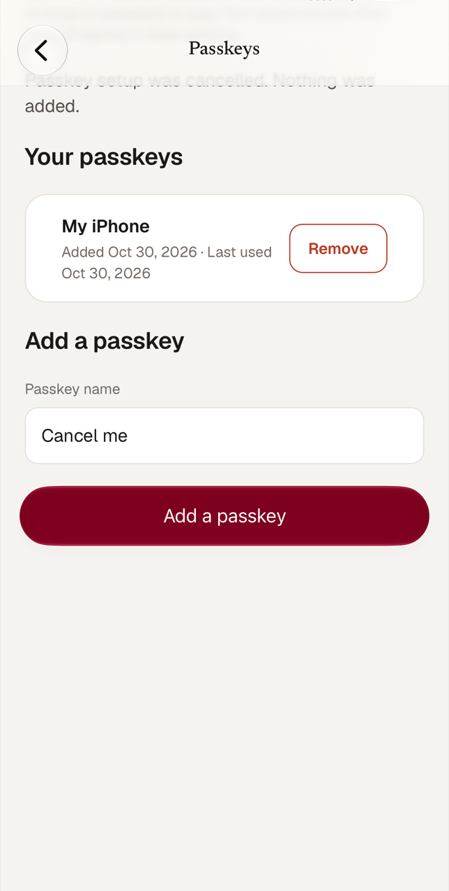 |

### Rules and refusals

| Sign in again first | Refused by the server | Disabled account |
| --- | --- | --- |
| 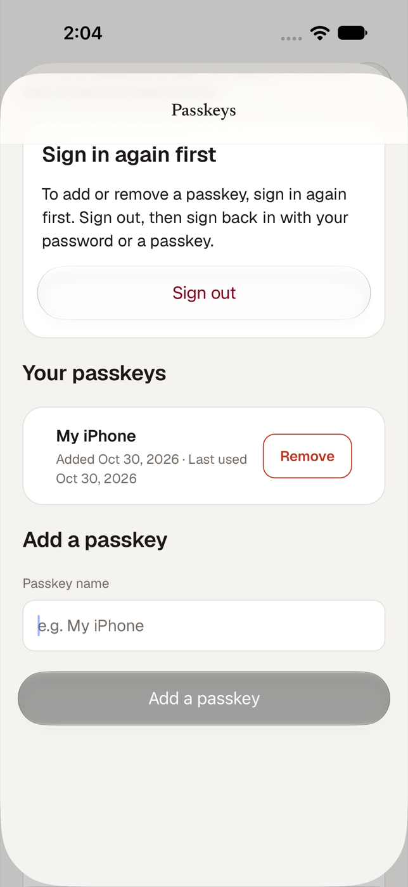 | 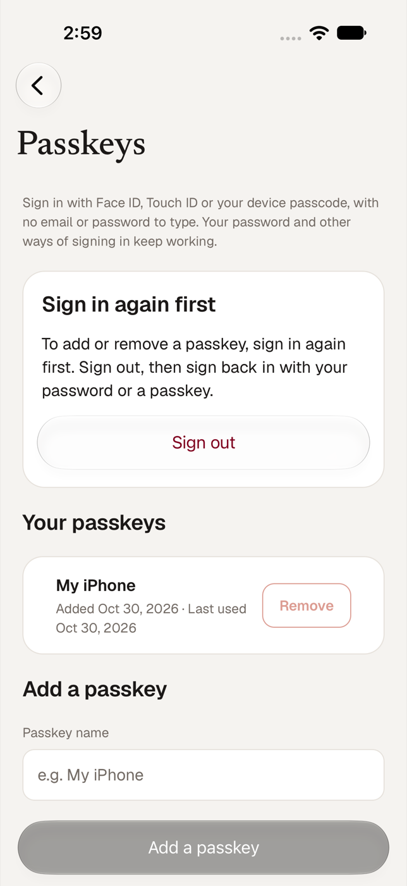 | 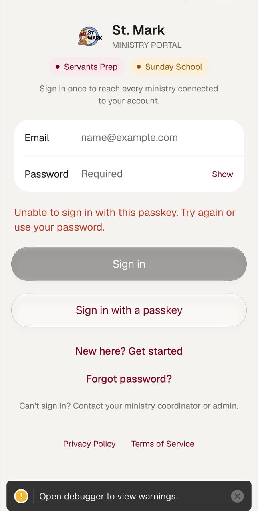 |

| Forced password change | View As |
| --- | --- |
| 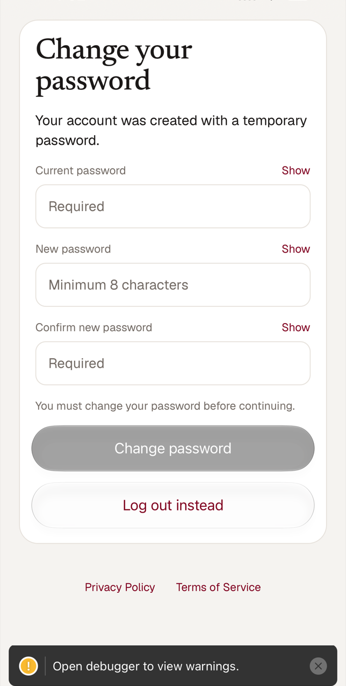 | 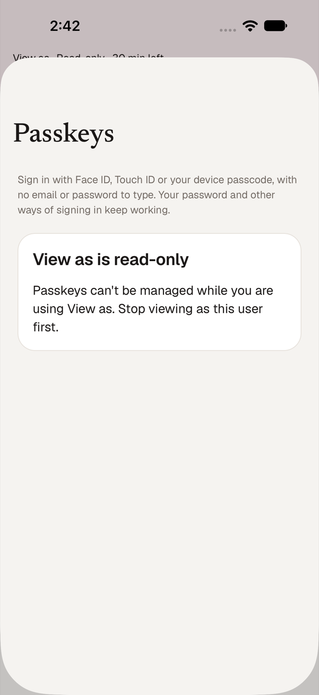 |

### Feature off

| Sign in | Account |
| --- | --- |
| 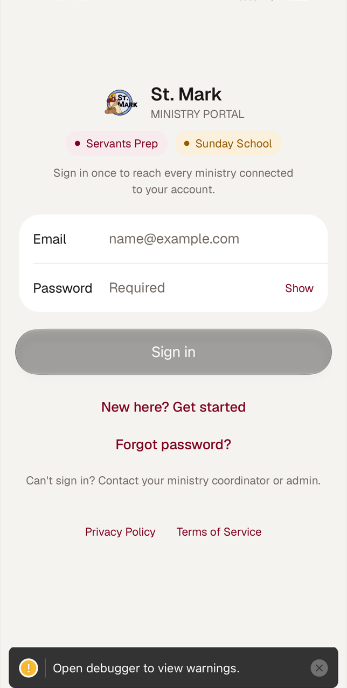 | 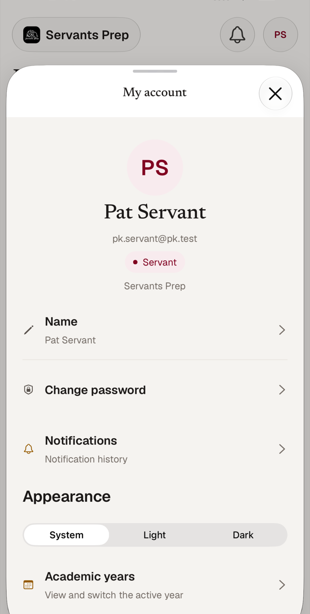 |

## Testing

### Automated

- `__tests__/mobile/passkeys.test.ts`: a software authenticator that behaves like
  Apple's platform authenticator (ES256, "none" attestation, user verification,
  `https://<RP ID>` origin, user handle as given) enrolls and signs in through the
  **real** SimpleWebAuthn verifier via the server's `registerPasskey` and
  `authenticatePasskey`. Replay, a tampered signature, a wrong user handle, a
  wrong RP ID and the origin mismatch are rejected. Also: the converter, challenge
  checks, offer logic, the ten-minute rule, error classification, the config
  plugin and screen wiring.
- `__tests__/mobile/passkey-client.test.ts`: the client sequence against a fake
  server: options → sheet → CSRF → callback → session; `Origin` and cookie scope;
  what is persisted; cancellation; generic failure; View As refused before the
  network.
- `__tests__/lib/passkeys.test.ts`, `__tests__/api/passkey-capability.test.ts`:
  the iOS origin allowance, App ID validation, the capability response and the
  association file.

### Simulator results

Run on the iPhone 18 Pro simulator (iOS 27) against a local server with a
trusted HTTPS host, using real Apple passkey sheets and Face ID.

| Scenario | Result |
| --- | --- |
| Enroll → sign out → sign in with the passkey → remove | Pass. Verified by the real server; `lastUsedAt` set; the list and empty states update. |
| Cancel the create sheet | Pass. Nothing added, name kept. |
| Disabled account, passkey sign-in | Pass. 401, generic message. |
| Forced password change, passkey sign-in | Pass. Lands on the change-password gate. |
| Add and remove with a sign-in older than ten minutes | Pass. Card, then a 403 from the server, message, passkey untouched. |
| View As | Pass. Row hidden, read-only screen, no passkey request reaches the server. |
| Another user deletes my passkey id | Pass. 404; the passkey remains. |
| Missing or wrong `Origin` | Pass. 403. |
| Forced-change account calls `/api/passkeys` | Pass. 403 `PasswordChangeRequired`. |
| Server has passkeys on but no iOS App ID | Pass. `ios:false`, association file 404, nothing offered. |
| Server has passkeys off | Pass. `enabled:false`, nothing offered. |
| Light, dark, and large text (accessibility size) | Pass. See screenshots. |

### Not covered

- A **physical iPhone** with the church's signing team against production. See the
  smoke test below.
- A **replayed or expired challenge on a device**: covered by the real-verifier
  tests and the server tests, not provoked by hand.
- The case where the RP ID is a **parent** of the web origin (the extra
  `https://<RP ID>` origin). Covered by tests; not run on a device.

### Reproducing the simulator run

Nothing leaves the machine. You need a host that resolves to this Mac and is
trusted by the simulator:

1. Use `*.localtest.me`, which resolves to `127.0.0.1`. Make a throwaway CA and a
   leaf certificate for, say, `stmark-pk.localtest.me`, and trust the CA in the
   simulator only: `xcrun simctl keychain <udid> add-root-cert ca.pem`.
2. Serve the dev API over HTTPS on **port 443** through a small proxy to
   `127.0.0.1:3100`. iOS looks up the bare RP ID host, so an association entry with
   a port never matches. macOS lets an unprivileged process bind 443 only on all
   interfaces, so accept connections from loopback and drop everything else.
3. Use a **throwaway database**: `createdb`, then `prisma migrate deploy` with
   `SP_DATABASE_URL` and `SP_DATABASE_URL_UNPOOLED` pointing at it. Seed a few
   users, with `canUseViewAs` set on one.
4. Run the dev server with `NEXTAUTH_URL`, `PASSKEY_ORIGIN` and `PASSKEY_RP_ID` on
   that host and `PASSKEY_IOS_APP_IDS=<team>.org.stmark.ministryportal`.
5. Prebuild and build with `EXPO_PUBLIC_API_URL=https://<host>` and
   `PASSKEY_ASSOCIATED_MODE=developer`, and start Metro with `--clear` (it caches
   the inlined API URL) and the same API URL in `apps/mobile/.env.local`.
6. Enroll Face ID in the simulator, then send a match when the sheet is up:

   ```sh
   xcrun simctl spawn <udid> notifyutil -s com.apple.BiometricKit.enrollmentChanged 1
   xcrun simctl spawn <udid> notifyutil -p com.apple.BiometricKit.enrollmentChanged
   xcrun simctl spawn <udid> notifyutil -p com.apple.BiometricKit_Sim.pearl.match
   ```

### Physical device smoke test

With a build signed by the team named in `PASSKEY_IOS_APP_IDS`, against the
production domain:

1. Sign in with a password, open **Account → Passkeys**, name a passkey, add it.
2. Sign out. Choose **Sign in with a passkey** and approve with Face ID.
3. Confirm the list shows the last-used date, then remove the passkey.
4. Confirm password sign-in still works, and that with `PASSKEY_IOS_APP_IDS` (or
   `PASSKEY_RP_ID`) unset the button and the Account row disappear.

## Troubleshooting

| Symptom | Cause and fix |
| --- | --- |
| "This version of the app isn't set up for passkeys with the server yet" | iOS refused the app for the domain. In the simulator log (`xcrun simctl spawn <udid> log show --last 5m --predicate 'process == "AuthenticationServicesAgent"'`) look for *"Application with identifier … is not associated with domain …"*. The App ID in `PASSKEY_IOS_APP_IDS` must match the signing team and bundle ID exactly, the association file must be served at the RP ID host with no redirect, and the build's entitlement must name that host without a port. |
| No sign-in button or Account row | The app hides passkeys unless the server answers `enabled`, `ios` and an `rpId` equal to the build's domain. `curl https://<host>/api/public/passkeys`. The capability is cached for five minutes; relaunch to refresh. |
| Sign-in fails fast against an HTTPS host in a dev client | Metro served a cached transform with the old API URL. Restart it with `--clear` and check `apps/mobile/.env.local`. |
| "Simulator requires enrolled biometrics to use passkeys" | Enroll Face ID in the simulator (see above). |
| Verification fails only when the RP ID is a parent domain | `PASSKEY_IOS_APP_IDS` must be set so the verifier also accepts `https://<RP ID>`. |

## Where the code is

| Area | Files |
| --- | --- |
| Native module | `apps/mobile/modules/passkeys/` (Swift, AuthenticationServices) |
| Conversion, offer logic, errors | `apps/mobile/src/data/passkeys.ts` |
| Native glue, capability, enroll, remove | `apps/mobile/src/data/passkey-native.ts`, `passkey-flow.ts` |
| Transport (cookies, `Origin`, View As guard, `signInWithPasskey`) | `apps/mobile/src/data/api-client.ts` |
| Screens | `apps/mobile/src/components/passkeys-screen.tsx`, `sign-in.tsx`, `account-screen.tsx` |
| Associated domain | `apps/mobile/plugins/withPasskeyDomain.js` |
| Shared types | `packages/contracts/src/passkeys.ts` |
| Server | `lib/passkey-config.ts`, `lib/passkeys.ts`, `app/api/public/passkeys/route.ts`, `app/.well-known/apple-app-site-association/route.ts` |
