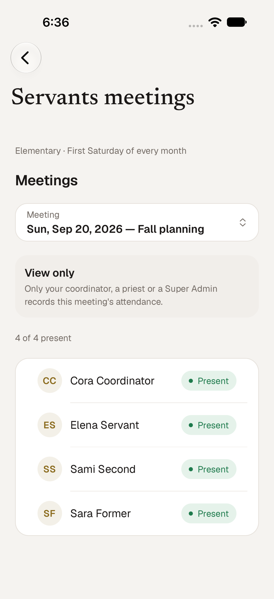
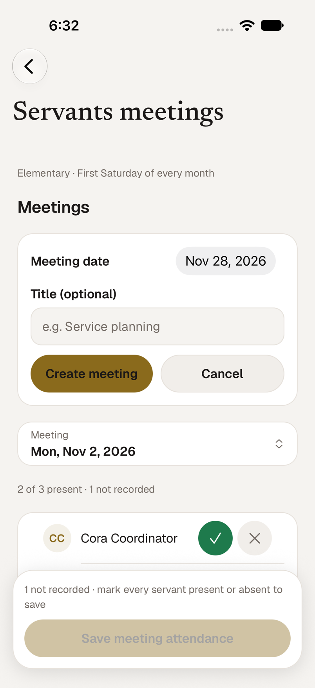
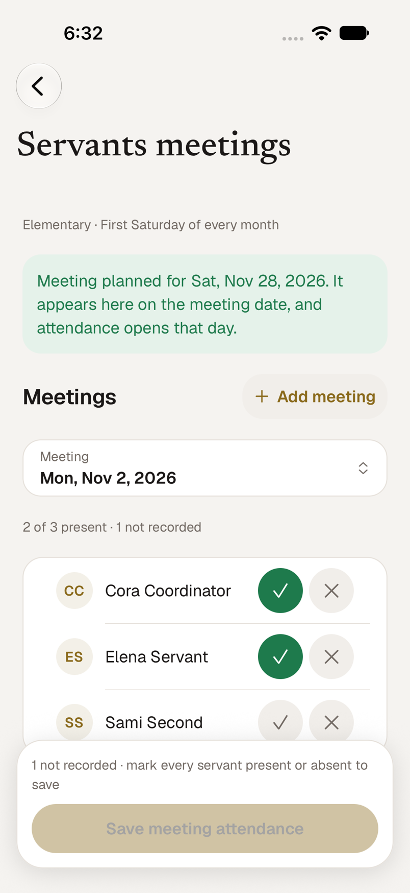
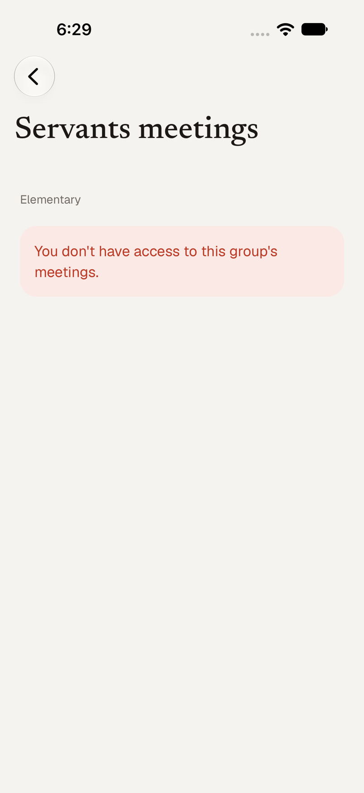
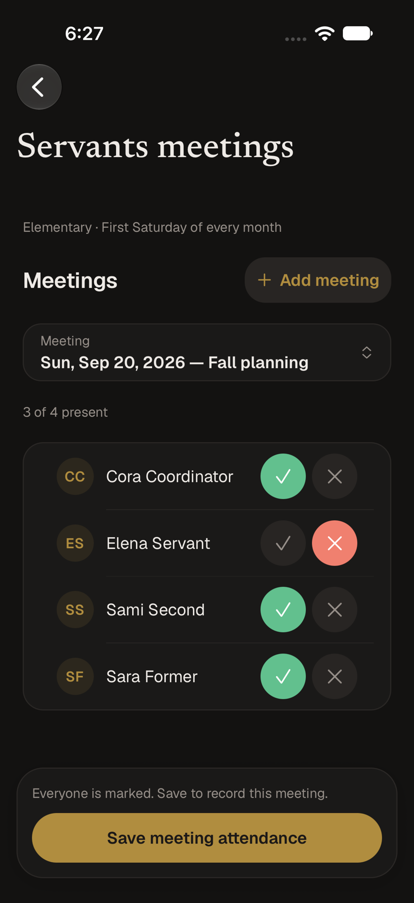
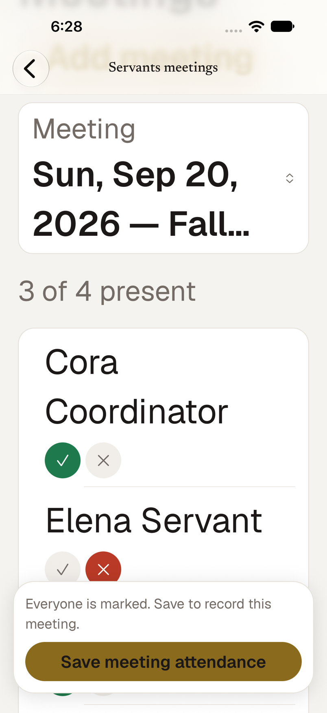

# Servants meetings in the iOS app (SMM-112)

**More → Servants meetings** (also reachable from Servant attendance, search and the
web's meeting links) is the native version of the web's *Servant Attendance → Servants
meetings* page: the list of a school group's meetings, creating one on demand, and
recording who attended. It uses only the deployed
`/api/sunday-school/servants-meetings` endpoints (GET to list and load, POST to create,
PUT to save); the server decides everything about access.

| Servant: view only | Add a meeting | Planned ahead, attendance incomplete |
| --- | --- | --- |
|  |  |  |

## What each person can do

The app asks the API and shows what it answers; nothing is decided from a role name.

| Who | Sees | Can |
| --- | --- | --- |
| A servant assigned to a class in the group | That group's meetings and attendance | View only |
| The group's coordinator, a priest, a Super Admin | Every meeting in the group | Create, record and correct attendance |
| A servant with no class in the group | Nothing for it: the group is not listed, and the API answers 403 if asked | Nothing |
| Anyone during View As | As the viewed account | Read only; Add and Save are hidden and the API client refuses writes |

Which groups are offered is the web's own rule (`lib/sunday-school-meeting-groups.ts`) applied to
the dashboard: administrators and read-only viewers get what the API lists, others get groups they
coordinate or have a class in. An Elementary servant therefore sees Elementary; the app does not
hard-code a band. If a coordinator's authority is removed mid-session, the next request is a 403: the
screen says *You no longer have permission to do that for this group* and reloads.

| Permission removed mid-session | Dark | Largest text |
| --- | --- | --- |
|  |  |  |

## Rules

- **Opening the screen creates nothing.** Browsing is GET only. A monthly date the server projects
  (first Saturday for Elementary, third Sunday for other groups) is listed as a placeholder and only
  becomes a real meeting on its first save; the screen then follows the new meeting ID.
- **Creating is explicit and repeatable.** *Add meeting* takes a date and an optional title (200
  characters). POST is an upsert on group + year + date, so adding a date that already has a meeting
  opens the existing one and keeps its title.
- **Plan ahead, record on the day.** A later date is accepted and confirmed (*Meeting planned for Sat,
  Nov 21*), but the list shows meetings up to today and the server refuses to open a future one, so it
  appears on its date. Attendance can be recorded from the meeting's own day (the church's
  America/New_York calendar, re-read at midnight and when the app returns) and past attendance stays
  correctable.
- **The roster** is the group's current servants plus anyone already saved on the meeting, so someone
  whose assignment has ended stays visible with their recorded mark. People are listed once.
- **Every attendee is marked Present or Absent.** *Save meeting attendance* stays disabled while anyone
  is unmarked, says how many, and sends the whole list in one PUT; the server saves it in one
  transaction. There is no Excused or Late, and nobody is assumed absent.
- **Changes while editing.** If the roster changed under you (someone's assignment ended), the save is
  refused; the screen reloads, drops marks for people no longer listed, keeps the rest, and asks for
  another look. A 404 (meeting gone) and other refusals show their reason. Nothing is half-saved.
- **Not in this screen:** the web page also has a geofenced *Check in for this meeting* for assigned
  servants (a separate PATCH with the device's location). That is outside this ticket and is not built
  here; the app never calls it.

Where it lives: `app/servants-meetings.tsx` (screen), `data/servants-meetings.ts` (pure rules: groups,
the date gate, create and save checks, failure wording), shared types in
`packages/contracts/src/sunday-school.ts` (`SundaySchoolServantsMeeting*`, type-only).

## Verification

**Automated:** `bunx tsc --noEmit` (root and `apps/mobile`), `bun lint`, `bun test:run`.
`__tests__/mobile/servants-meetings.test.ts` (21) covers the group rule, the date gate (editable on
and after the day, not before, view-only without authority or in View As), create checks and the
open-or-plan outcome, the all-marked save body, mark reconciliation, failure wording, and the screen's
wiring (the only POST and PUT are inside Add and Save). The server's own contract is in
`__tests__/api/sunday-school-servants-meetings.test.ts`.

**Simulator** (iPhone 18 Pro, iOS 27, the real dev API on a throwaway database with an Elementary
band, a High School group, a coordinator, a priest, a Super Admin, three servants and a servant whose
assignment had ended):

| Case | Result |
| --- | --- |
| Assigned Elementary servant | Sees the meetings and the roster, including the servant whose assignment ended; no Add button, no marks to change |
| Servant of another band (non-Elementary) | Is offered only their own group (*Third Sunday of every month*); asking the API for Elementary is a 403 |
| Opening the screen | No meeting rows created |
| Add a date that already has a meeting | The existing meeting opens, title kept, still one row |
| Plan a future Saturday | Row created, confirmed on screen; not listed and a direct GET answers 404 |
| Incomplete save | Disabled, with the count of people not recorded |
| Correct a past meeting and save | Four explicit marks saved, recorder is the coordinator |
| Save a projected monthly date | It became a real meeting on first save and the screen followed it |
| Coordinator's authority removed before saving | 403 shown in plain words; nothing written |
| A servant's assignment ended after the roster loaded | Save refused, roster reloaded without them, marks kept, second save succeeded |
| Light, dark, largest text size | Readable; at the largest size each row stacks its name above its controls |

**Not verified:** a physical iPhone; typing a title into the Add form on the simulator (the test harness
hung on that field), so the title path rests on the unit tests and on curl against the API; a priest
and a Super Admin creating a meeting from the app (their create permission was confirmed against the
real API, while the screen was exercised as the coordinator).
