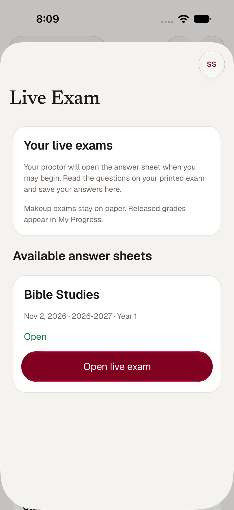
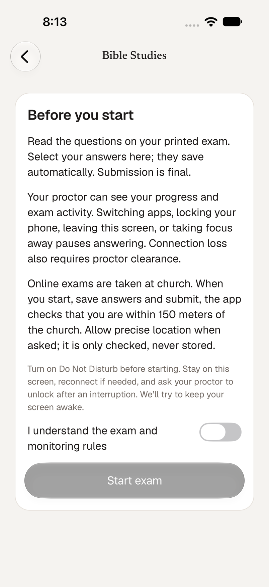
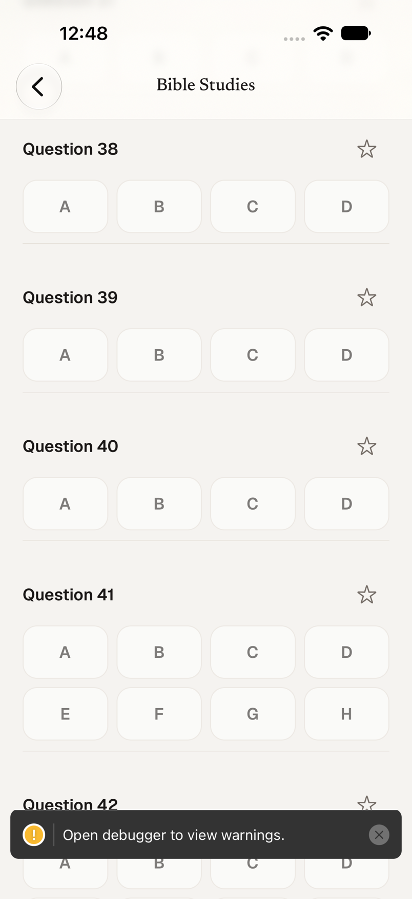

# Native live exams and proctoring

This is the Servants Prep original-exam workflow. Students still read printed
questions. Paper makeup exams and score entry remain separate.

## Open the feature

- Prep servants, priests and super admins: **Servants Prep → More → Exam
  Monitoring**, or **Exams → Exam Monitoring**. Controls follow the API's
  `canManage` flag, so priests can manage exams like the other administrators;
  a View as session is read-only.
- Prep students: **Home → Live Exam** or **More → Live Exam**. Only eligible
  exams opened by the proctor are returned by the existing API.
- Both destinations are searchable in the Prep Search tab. Exam notification
  links also open the corresponding native list or detail screen.

The monitoring dashboard supports the same 50-answer setup, A–B through A–H
choice counts, opening, closing, setting ready, test-opening reset, result
release, individual retakes, student unlocking, and preserved history as the
web. Compact student cards open live connection details and activity history.
The answer key is available only in the server's management response; native
students and priests never receive it.

The dashboard polls every two seconds while focused and active. A failed
refresh removes the previous live status and controls until a successful
refresh. It does not label cached status as live. New interruption events
produce visible alerts and a haptic, with optional audible local notification
alerts. Existing events are deduplicated; answer saves do not sound.

## Student behavior

Students acknowledge the monitoring notice before starting. Answers autosave
one at a time using the API's revision and session-token checks. Saves,
heartbeats, activity reports and submission are serialized so a slow response
cannot race another write. The app sends heartbeats every ten seconds and
refreshes the visible answer sheet every two seconds to observe unlocking and
exam state changes. No Pusher credentials are needed on the phone.

Tapping an already selected choice clears it. Students may star questions and
switch to **Review starred questions** without losing their place in the exam.
Stars persist with the encrypted draft for that account, device and attempt
version; they are not sent to the proctor and do not affect grading. A retake
or final submission clears them. Submission warns about remaining stars.

App backgrounding, iOS inactive state, Android focus loss, or navigating away
immediately blocks local answering and queues the existing HIDDEN/BLUR events.
Return reports visibility without clearing the server pause. Connection
failure preserves pending choices; reconnect reports OFFLINE/RECONNECTED and
requires proctor clearance before retrying answers. No other app's identity or
contents are inspected. OS suspension can delay network delivery, so proctors
also see the existing 30-second stale-contact indicator.

Pending choices, the answering-session token and retry IDs are stored in
encrypted, device-only Keychain/Keystore items scoped to the API origin,
account and exam. Large drafts use chunks with an atomic manifest. Saved
server answers, answer keys and grades are not persisted in this store.
Submission deletes the pending draft; a new attempt version discards the
previous version's pending choices. The token is preserved before Start is
sent, so a lost response can recover the same session. Resuming an existing
attempt requires clearance even if the previous process stopped before it
could queue an interruption report. Brief interruptions during Start are also
reported, including when the student returns before the request finishes.
The server remains authoritative across
web and native sessions. Switching to a different answering session follows
the existing 30-second recovery and proctor-unlock rules.

The screen requests native keep-awake while an open attempt is visible and
started, and releases it on submission, closure or departure. Locking a device
still pauses answering. View As cannot start, answer, submit, or manage an exam.

## Church location requirement

The server requires a verified position on every **start, answer save and submit** (`lib/digital-exam-service.ts`,
`lib/exam-geofence.ts`; [`digital-exams.md`](digital-exams.md) has the rules): captured within two minutes, accurate to 100
meters, within 150 meters of 427 Westside Ave. Without it every one of those calls is refused, so the native app must send one.
(This arrived with the merge from `main` after the screens below were first built; until it was added here, a student could not
start an exam against the current server.)

| Student list | Start card | Answer sheet |
| --- | --- | --- |
|  |  |  |

- **How.** `data/exam-location.ts` takes a fix through `expo-location` (when-in-use only; a new native dependency). Start and Submit
  take a fresh fix; an autosave may reuse one up to a minute old; heartbeats and activity reports never carry a position, as on the
  web. The position lives in memory: it is not in the encrypted draft, not stored anywhere, and not logged.
- **A location problem is not an outage and not a revoked session.** If the device cannot give a usable position (permission asked
  and refused, blocked in Settings, Location Services off, accuracy worse than 100 m, a stale fix) or the server refuses it (400
  stale or imprecise, 403 outside the boundary), the attempt stays open and monitored, pending answers stay on the device, no
  `OFFLINE` report is queued, and the screen shows **Location needed** with the reason (and **Open Settings** when only Settings can
  fix it). A tap, Submit or Start retries at once; otherwise autosaves wait five seconds between tries. The server's 403 for
  "outside the boundary" must not be read as lost access, which is why the controller recognizes the server's wording.
- **Permission string.** `NSLocationWhenInUseUsageDescription` only: *Used during an online exam to confirm you are at church. Your
  location is checked when you start, save and submit, and is never stored.* The "Always" strings are removed by the plugin
  configuration in `app.json`.
- **A new native build is required** (a native module and an Info.plist key). A JavaScript update alone cannot add them.

Start, Resume and Submit are plain pressable buttons (`components/exam-action-button.tsx`) rather than the shared SwiftUI-hosted
button: the hosted button was seen not to appear on the Resume card in several relaunches, and these are the actions a student
cannot do without.

## Criteria, and the evidence for each

| Criterion | How it is met | Verified by |
| --- | --- | --- |
| `GET /api/digital-exams`, `GET`/`POST /api/digital-exams/[id]`, server eligibility, acknowledgment first | `live-exam-list.tsx`, `use-live-exam.ts`, the Start card's switch | Simulator on the real API; integration suite |
| 50 answers, A–B to A–H per question, selected feedback, pending/saved, submit after saves finish | `exam-answer-choices.tsx`, controller `flushAnswers` and `submit` | Simulator (4- and 8-choice questions); controller tests |
| Revisions, ownership, heartbeat, pause, reconnect, unlock; foregrounding never clears a pause | controller `apply`, `refresh`, `failure` | Controller tests; integration suite; on the simulator a relaunched attempt came back `PAUSED` (server `CONTACT_LOST`, then `RECONNECTED`, `RETURNED`) until the proctor unlocked it |
| App backgrounding/inactivity and lost connection map to the existing contract; keep awake | `HIDDEN`/`RETURNED`/`BLUR`/`OFFLINE`/`RECONNECTED`; `useExamAwake` | Controller and hook tests; integration suite. iOS has no browser focus events, so `inactive` maps to `BLUR` + `HIDDEN` and Android uses its own `blur`/`focus` |
| Pending answers and events preserved per account and exam, retried without duplication, cleared on finalization | chunked Keychain store, event IDs, `persist()` | Controller tests; integration suite |
| No answer key, no unreleased grade | the student GET omits the key; a result shows only when the server sent one | Real API (`answerKey` absent from the student response); wiring test |
| Church location on start, save, submit | this section | Locator tests against the server's own validator; controller tests; integration suite; simulator start at the church |

## Build and verification

The existing `/api/digital-exams` endpoints provide all data and enforce current
database authority, enrollment eligibility, private results, and transaction
locks. This feature adds no endpoint, schema change or permission grant.
Shared API shapes live in `packages/contracts/src/digital-exams.ts`; shared
activity labels live in `packages/domain/src/exam-activity.ts`.

The Expo notifications plugin bundles the same six proctor WAV clips as the
web. **A new native build is required for these sound assets**; a JavaScript
update alone cannot add them to an installed binary. Sound is off initially,
requires notification permission, and follows the device's notification,
volume and Focus settings. Audible alerts are spaced by at least eight seconds
to avoid overlapping clips. Student devices remain silent.

Verification commands:

```sh
bun run mobile:typecheck
bunx tsc --noEmit
bun lint
bun test:run
bun run mobile:export
```

The full jsdom suite requires a compatible Node runtime (validated with Node
20.20.0); Node 26's experimental global localStorage conflicts with the web
tests. Native controller tests cover slow save acknowledgments, focus loss
during saving, offline recovery, blocked saves, revision conflicts, durable
draft restoration, versioned retakes, closure, final submission, and denial.
Queued writes cannot block reading a proctor-finalized submission or a new
retake version. A rejected ownership check blocks answering until the student
explicitly resumes. Monitoring cancels background reads and ignores late
responses; manual refresh shares the current read instead of racing it.
Hook tests cover monitoring freshness and native keep-awake cleanup.

The database suite also runs the native controller through the actual API for
save/clear, interruption/unlock, grading secrecy, offline closure, lost
submission responses, retakes and competing sessions. It was validated against
an isolated local PostgreSQL database. Database integration tests require an
explicitly isolated test database as described in `digital-exams.md`.
Rehearse on physical devices before a real
exam, especially interruption delivery, sounds, and Focus behavior.
